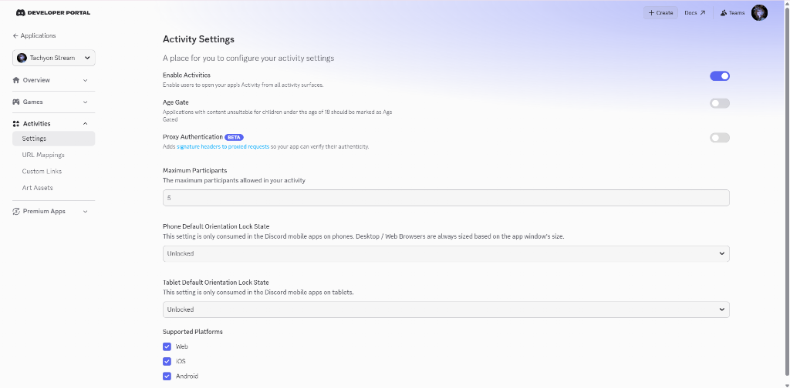
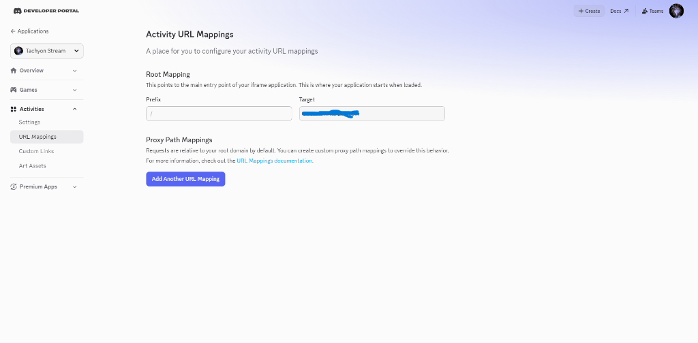

<div align="center">

# ⚡ TachyonStream

**セルフホスト対応 リアルタイム同期動画ストリーミングプラットフォーム ＆ Discord Watch Together アクティビティ**

[](https://nodejs.org/)
[](https://expressjs.com/)
[](https://socket.io/)
[](https://discord.js.org/)
[](../LICENSE)

[English](../README.md) • [日本語](README_JA.md) • [ภาษาไทย](README_TH.md)

</div>

---

## キーボードショートカット

再生操作は動画を選択した後に利用できます。

- **Space / K:** 再生・一時停止
- **← / J:** 10秒戻る
- **→ / L:** 10秒進む
- **↑ / ↓:** 音量を5%ずつ変更し、ミュートを解除
- **M:** ミュート切り替え
- **F:** 全画面表示の切り替え
- **Esc:** ダイアログを閉じる、または Cinema/Upload から Library に戻る。入力欄や選択リストにフォーカスがある場合は通常のキー操作を優先します。全画面表示中はブラウザーが先に全画面を解除します。
- **?:** ショートカット一覧を表示。ナビゲーションの `?` ボタンでも開けます。

英字キーは英語配列上の物理キー位置を使います。入力欄、選択リスト、フォーカス中のボタン、Upload画面、ダイアログの操作を妨げず、Ctrl/Alt/Commandとの組み合わせは処理しません。

再生・一時停止・シークは既存の操作と同様にルームへ同期します。音量と全画面表示は操作中のページだけに適用されます。


## 📖 概要

**TachyonStream** は、複数人での同時視聴体験のために設計された、軽量・高レスポンスかつ安全なセルフホスト型メディアストリーミングサーバーです。ルーム内でのリアルタイム再生同期、チャンク分割による動画アップロード、自動サムネイル生成、階層型フォルダ管理、そして **Discord Watch Together ボイスアクティビティ** としてのシームレスな統合を提供します。

---

## ✨ 主な機能

- 🔄 **リアルタイム再生同期:** Socket.IO ルームを活用し、再生・一時停止・シーク・再生速度の変更、および動画の切り替えを全参加者間で遅延なく完全同期。
- 📁 **スマートなフォルダ・ライブラリ管理:** 階層型フォルダナビゲーション、入れ子ディレクトリのサポート、動画の移動、および内部動画に基づく動的なフォルダサムネイルのカスケード表示。
- 🖼️ **自動サムネイル生成:** FFmpeg によるアップロード時の自動サムネイル＆再生時間抽出、一括生成スクリプト、およびブラウザ側キャプチャによるフォールバック機構を搭載。
- 🚀 **チャンク分割アップロード:** 大容量動画ファイルをスライス分割してアップロード。サーバー側での自動組み立て、一時ファイルのクリーンアップ、整合性検証を実行。
- 🤖 **Discord アクティビティ＆ボット連携:** Discord Embedded App SDK を使用し、ボイスチャンネル内で `/watch` コマンドを実行するだけで Watch Together セッションを直接起動可能。
- 🛡️ **ゼロトラスト・セキュリティ設計:**
  - **静的直接アクセスの完全遮断:** `public/uploads/` や `temp_chunks/` への生アクセスを完全にブロック（大文字・小文字の偽装や URL エンコード攻撃も防御）。メディアは `/api/stream` 経由でのみ、HTTP Range リクエストとセッション検証を伴って安全に配信されます。
  - **セッション検証:** ライブラリの変更やストリーミング要求に対して、アクティブなプレイヤーセッショントークン（`X-Playback-Session`）を必須化。
  - **Origin & Metadata 保護:** Origin および `Sec-Fetch-*` ヘッダーを検証し、不正なクロスオリジン API 呼び出しやクロスサイト WebSocket ハイジャックを確実に防止。

---

## 🛠️ 前提条件

- **[Node.js](https://nodejs.org/)** (v18.0.0 以上を推奨)
- **[FFmpeg](https://ffmpeg.org/)** および **FFprobe**（システム `PATH` への登録を推奨。動画再生自体は不要ですが、サーバー側での自動サムネイル抽出に必要です）。
  - *環境変数 `FFMPEG_PATH` および `FFPROBE_PATH` でカスタム実行パスを指定することも可能です。*

---

## 🚀 クイックスタート

### 1. リポジトリのクローンと依存関係のインストール

```bash
git clone https://github.com/Minta1234/TachyonStream.git
cd TachyonStream
npm install
```

### 2. 環境変数の設定

サンプル環境設定ファイルをコピーします:

```bash
cp .env.example .env
```

利用可能な環境変数:

| 変数名 | 説明 | デフォルト値 |
|---|---|---|
| `PORT` | Web サーバーの待受ポート | `9815` |
| `TUNNEL_TOKEN` | 外部公開用 Cloudflare Tunnel トークン (任意) | *(未設定)* |
| `DISCORD_TOKEN` | Watch Together 起動用 Discord ボットトークン | *(未設定)* |
| `DISCORD_CLIENT_ID` | Discord アプリケーションのクライアント ID | *(未設定)* |
| `FFMPEG_PATH` | `ffmpeg` バイナリへのパス | システム PATH |
| `FFPROBE_PATH` | `ffprobe` バイナリへのパス | システム PATH |

### 3. サーバーの起動

#### 開発モード / 直接実行
```bash
npm start
```
起動後、ブラウザで `http://localhost:9815` にアクセスしてください。

#### バックグラウンドサービス実行 (Windows)
ターミナルウィンドウを開いたままにせず、ストリーミングサーバーとバックグラウンドタスクをサイレント起動する場合:

```cmd
start.bat
```

起動中のバックグラウンドプロセスを一括停止する場合:

```cmd
stop.bat
```

*(プロセス ID は `.processes.json` で管理されるため、他の無関係な Node.js プロセスを終了することはありません)*

---

## 🌐 Cloudflare Tunnel の設定 (外部公開 ＆ HTTPS 化)

Discord アクティビティは、Discord の CDN ドメイン（`*.discordsays.com`）上の iframe 内で動作するため、安全な **HTTPS** エンドポイントが必須となります。Cloudflare Tunnel を利用すれば、ルーターのポート開放（ポートフォワーディング）や自宅のグローバル IP を晒すことなく、ローカルの TachyonStream サーバーを安全に外部公開できます。

### ステップ 1: `cloudflared` のインストール
- **Windows:**
  ```powershell
  winget install --id Cloudflare.cloudflared
  ```
  *(または [Cloudflare Releases](https://github.com/cloudflare/cloudflared/releases) から `cloudflared.exe` をダウンロードし、システム PATH に配置)*
- **Linux:**
  ```bash
  sudo apt install cloudflared
  ```

### ステップ 2: Cloudflare Zero Trust で Tunnel を作成
1. [Cloudflare Zero Trust ダッシュボード](https://one.dash.cloudflare.com/) > **Networks** > **Tunnels** にアクセスします。
2. **Create a Tunnel** をクリックし、**Cloudflare Tunnel (cloudflared)** を選択します。
3. Tunnel 名（例: `tachyonstream`）を入力して保存します。
4. 発行された **Tunnel Token**（`ey...` で始まる Base64 文字列）をコピーします。

### ステップ 3: パブリックホスト名 (Public Hostname) の登録
Tunnel の設定画面にて:
1. **Public Hostnames** タブを開き、**Add a public hostname** をクリックします。
2. 以下の通り設定します:
   - **Subdomain:** 例: `stream`
   - **Domain:** お手持ちのドメイン (例: `yourdomain.com`、全体で `stream.yourdomain.com`)
   - **Service Type:** `HTTP`
   - **URL:** `localhost:9815`
3. ホスト名を保存します。

### ステップ 4: TachyonStream との連携起動
起動プロセス環境変数に `TUNNEL_TOKEN` を設定します:
```powershell
$env:TUNNEL_TOKEN="your_tunnel_token_here"
```
または `start.bat` を実行すると、`launch.ps1` が自動的に `TUNNEL_TOKEN` を検出し、バックグラウンドで `cloudflared tunnel run` を立ち上げ、出力を `tunnel.log` に記録します。

---

## 🎮 Discord Developer Portal でのアクティビティ設定

TachyonStream を Discord 公式ボイスアクティビティとして設定する手順:

### 1. アプリケーションの作成
1. [Discord Developer Portal](https://discord.com/developers/applications) にログインします。
2. **New Application** をクリックし、アプリ名（例: `Tachyon Stream`）を入力します。

### 2. アクティビティ設定 (`Activities` > `Settings`)
アクティビティの基本設定を行います:
- **Enable Activities:** **ON** に切り替え（アクティビティの起動を許可）。
- **Age Gate:** **OFF**（18 禁コンテンツを配信する場合のみ ON）。
- **Proxy Authentication:** **OFF**。
- **Maximum Participants:** 同時参加上限数（例: `5` 〜 `25`）。
- **Default Orientation:** スマートフォン (Phone) およびタブレット (Tablet) 共に **Unlocked** に設定。
- **Supported Platforms:** ✅ **Web**、✅ **iOS**、✅ **Android** のすべてにチェック。

<p align="center">
  
</p>

### 3. URL マッピング設定 (`Activities` > `URL Mappings`)
Discord のリバースプロキシを Cloudflare Tunnel のドメインへ紐付けます:
- **Root Mapping:**
  - **Prefix:** `/`
  - **Target:** `stream.yourdomain.com` *(プロトコル `https://` を除いたホスト名のみ入力)*
- *動作の仕組み:* ユーザーがアクティビティを起動すると、Discord は `https://<app_id>.discordsays.com/` 経由でリクエストを中継し、HTTPS 経由で指定した Tunnel ホストへ安全にアクセスします。

<p align="center">
  
</p>

### 4. ボットの認証と権限設定 (Bot & OAuth2)
1. 左メニューの **Bot** を開き、**Reset Token** をクリックしてボットトークンをコピーします。
2. `.env` ファイルにトークンを記述します:
   ```env
   Discord_token=your_bot_token_here
   ```
3. **OAuth2** > **URL Generator** を開きます:
   - **Scopes:** `bot`、`applications.commands`
   - **Bot Permissions:** `Create Instant Invite`、`Send Messages`、`View Channels`
4. 生成された招待 URL から、ボットをご自身の Discord サーバーに参加させます。

---

## 🤖 Discord Watch Together ボット

設定完了後、同梱の Discord ボットを起動してボイスチャンネル内でセッションを開始します:

1. ボットを起動:
   ```bash
   npm run bot
   ```
2. Discord の任意のボイスチャンネルに入室します。
3. チャット欄で以下を実行します:
   ```text
   /watch
   ```
4. ボットがチャンネル内にインタラクティブボタンを生成し、メンバー全員がワンクリックで同期ストリーミングアクティビティに参加できます。

---

## 🎬 サムネイルの一括生成

ライブラリ内の既存の全動画に対して、一括でサムネイルカードを生成する場合:

```bash
npm run thumbnails
```

*既存の動画ファイルを変更することなくスキャンし、未生成の動画についてのみ `public/thumbnails/` に `.jpg` 画像を生成します。*

---

## 🧪 テストの実行

セキュリティ検証、アップロードスライスの整合性、セッション処理などを網羅した自動回帰テストスイートを実行できます:

```bash
npm test
```

本番の動画ライブラリに影響を与えず、隔離された一時ワークスペース上で安全に検証が行われます。

---

## 📂 プロジェクト構成

```text
TachyonStream/
├── docs/                   # 多言語ドキュメント (日本語, タイ語)
│   ├── README_JA.md
│   └── README_TH.md
├── lib/
│   └── thumbnails.js       # FFmpeg サムネイル生成ヘルパー
├── public/                 # フロントエンド静的ファイル (HTML, CSS, プレイヤー JS, Treeselect)
│   ├── app.js              # クライアントアプリケーション ＆ ルーム同期ロジック
│   ├── thumbnails/         # キャッシュされたサムネイル画像 (.jpg)
│   └── uploads/            # 動画ライブラリ保存ディレクトリ
├── scripts/
│   └── generate-thumbnails.mjs # サムネイル一括スキャンスクリプト
├── tests/
│   └── regression.mjs      # セキュリティ ＆ 回帰テストスイート
├── bot.js                  # Discord Watch Together ボット
├── launch.ps1              # プロセス監視・管理スクリプト
├── server.js               # Express ＆ Socket.IO バックエンド本体
├── start.bat               # Windows バックグラウンド起動用スクリプト
└── stop.bat                # Windows バックグラウンド停止用スクリプト
```

---

## 📄 ライセンス

本プロジェクトは [MIT License](../LICENSE) の下で公開されています。

## カードの操作メニュー

動画とフォルダーの右下にある三点ボタンをクリック、または Tab と Enter で開きます。Tab で操作を選択し、Esc で閉じて元のボタンにフォーカスを戻せます。プレビューと非表示画面は操作を妨げません。小さい画面ではナビゲーションと検索欄が折り返されます。アップロード完了までページを開いたままにしてください。再読み込み後の再開には対応していません。

画面内のアイコンは絵文字ではなく SVG を使用します。ブラウザー標準の選択肢はテキスト表示です。

## ストリーミングの最適化

開始位置のみの Range は 3 MB ごとに切らず、バックプレッシャー付きで送信します。suffix Range と本文を読まない HEAD、非同期のファイル情報取得に対応します。プレビューは 700 ms 後に開始し、本編再生中、非表示タブ、Data Saver、2G では開始しません。サムネイルは遅延読込と非同期デコードを使用し、フォールバック処理は同時に1件、本編再生中は待機します。ライブラリー取得を直列化し、同じデータではカードを再構築しません。

セッション検証と共有キャッシュ禁止は維持します。HLS 準備中は元ファイルを配信し、準備後は Auto 品質を利用できます。実際の回線での速度検証は別途必要です。

## Auto と手動画質

上部の Quality から Auto、Original、生成済みの 360p/480p/720p/1080p を選択できます。元動画より高い解像度は生成しません。360p 未満は元の高さを偶数に揃えます。Auto は HLS で帯域とバッファーに応じて画質を調整します。手動設定は視聴中の端末だけに適用され、ルームの動画と再生位置は共通です。Original/HLS の切り替えでは位置と再生状態を保持しますが、短い再読み込みが生じる場合があります。

初回再生で変換をキューに追加し、準備中は Original を再生します。全画質の生成後に Auto が利用可能になります。npm ci、FFmpeg/FFprobe、libx264 と AAC が必要です。対応ブラウザーは同梱の hls.js、Safari のフォールバックは native HLS を使います。

変換は同時1件、encoder 2 threads、待ちキュー最大4件です。長い動画の変換には時間がかかり、ページを閉じても続行します。生成物は DATA_DIR/adaptive/（既定 public/adaptive/）に保存され、追加のディスク容量を使います。開始前に容量を見積もり512 MBの空きを確保しますが、古い cache は自動削除しません。元ファイルは変更しません。移動・削除後の古い生成物は配信されません。

Playlist と segment は session/referer で保護します。変換失敗時や非対応端末は Original を利用できます。最低画質の帯域を下回る回線では停止が起こり得ます。

Auto/Original だけの場合はステータスを確認してください。FFmpeg/FFprobe が見つからない場合は .env の FFMPEG_PATH/FFPROBE_PATH に絶対パスを設定してサーバーを再起動し、Retry quality を押します。変換失敗や容量不足の理由も表示します。
